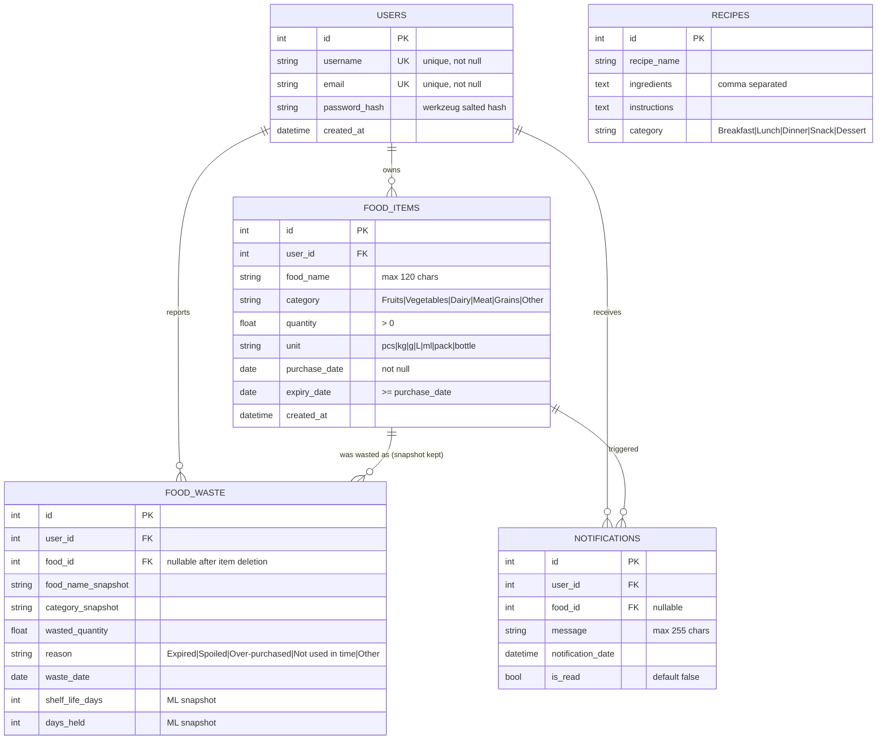

# FoodWise - Entity Relationship Diagram

## 1. ER diagram (Mermaid)

## 2. Relationship summary

| Relationship | Cardinality | Notes |
| --- | --- | --- |
| users → food_items | 1 : N | `ON DELETE CASCADE` via SQLAlchemy `delete-orphan` |
| users → notifications | 1 : N | cascade with the user |
| users → food_waste | 1 : N | cascade with the user |
| food_items → food_waste | 1 : N | waste rows **survive** item deletion thanks to snapshot columns (ML history is preserved) |
| food_items → notifications | 1 : N | reminder rows reference the item; unread ones are closed when the item is removed |
| recipes | standalone | shared catalogue, seeded on first run, no user link |

## 3. Derived (non-stored) fields

| Model | Property | Definition |
| --- | --- | --- |
| FoodItem | `days_to_expiry` | `expiry_date - today` (negative = expired) |
| FoodItem | `status` | `expired` if `< 0`, `near` if `<= 3`, else `safe` |
| FoodWaste | `utilisation_ratio` | `days_held / shelf_life_days`, clipped to 0..1.5 |
| Recipe | `ingredient_list()` | splits the comma-separated ingredients text |

## 4. Data dictionary notes

- `password_hash` - generated with Werkzeug's `generate_password_hash`
  (salted PBKDF2 by default); plain passwords are never stored.
- `shelf_life_days` = `expiry_date - purchase_date` copied at waste time.
- `days_held` = `waste_date - purchase_date` copied at waste time; together
  with `shelf_life_days` it forms the ML target
  `utilisation_ratio = days_held / shelf_life_days`.
- `ML_TRAINING_THRESHOLD = 8` (config.py) gates model training on the count of
  `food_waste` rows per user.
